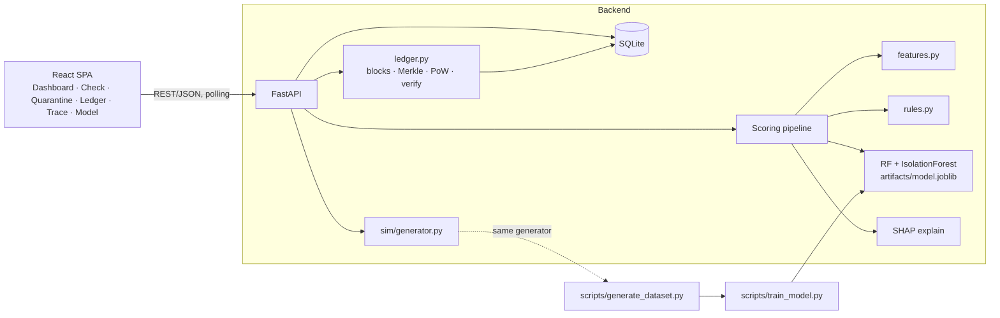

# AgriChain Sentinel — Design

> AgriChain Sentinel is a course-project web app that watches agricultural supply-chain transactions (farmer → cooperative → processor → distributor → retailer), scores each one for fraud with a hybrid ML + rules engine *before* it is recorded, and writes the outcome to a tamper-evident hash-chained ledger. Clean transactions are sealed into blocks; suspicious ones are quarantined for an auditor; anyone can later verify that history was not altered. It is built to be demonstrated in five minutes: a live transaction stream, one-click fraud injection, an explainable alert, and a "tamper with the ledger" button that the chain catches.

## 1. Overview
- **Core job:** Catch fraudulent agricultural supply-chain transactions before they are committed, and keep an auditable, tamper-evident record of every decision.
- **Target users:** (a) a **supply-chain auditor / compliance officer** reviewing flagged transactions on a desktop; (b) a **supply-chain participant** (cooperative manager, processor) submitting or checking a transaction; (c) the **course evaluator** watching a live demo. Primary context: laptop browser, projector.
- **Success looks like:** the 5-minute demo script (§4) runs end to end with no manual DB edits; held-out per-fraud-type recall ≥ 0.80 and overall PR-AUC ≥ 0.85 (on synthetic data, reported honestly as such); `GET /api/chain/verify` detects a tampered block and names the first broken index.
- **Non-goals:** a production blockchain network, real money movement, real farmer identity/KYC, real-time IoT hardware, mobile app, a public Ethereum deployment.

## 2. Assumptions and open questions
- **Assumed:** 2–3 students, comfortable with Python and JavaScript/React, ~4 weeks part-time, demo on a laptop, assessed by demo + report + viva.
- **Assumed:** the course accepts a **simulated single-node blockchain** (SHA-256 hash chain, Merkle roots, proof-of-work, chain verification) rather than a deployed Ethereum smart contract. *This is the biggest thing to confirm with your instructor.* If smart contracts are required, see the "Ethereum anchoring" item in Later — it is a contained 1–2 day add-on, not a rewrite.
- **Assumed:** **no real dataset** is needed. The ML model is **trained from scratch on a synthetic agri-transaction dataset we generate**, because (1) no pretrained Hugging Face model exists for tabular agricultural-transaction fraud — a pretrained text/vision model would be bolted on for show; (2) generating the data gives ground-truth labels for *which type* of fraud each case is, which drives the explanations and per-type evaluation. Limitation is stated openly in the report: synthetic data makes scores optimistic.
- **Assumed:** India-flavoured context (crops: wheat, rice, onion, tomato, soybean, mango; amounts in INR; mandi-style reference prices). Change `CROPS` and currency in one config file if you prefer another region.
- **Assumed:** no real login. A demo has one user; role switching is cosmetic (nav only). Real auth is cut.
- **Assumed:** UI references (screenshots/links) will be dropped in `docs/ui-references/` before M3; until then the UI uses neutral Tailwind tokens that are easy to restyle.
- **Open (default used meanwhile):** Is a written report with an ML evaluation chapter graded? → default: yes, so Model Insights is in MVP.

## 3. Feature scope

Candidates were brainstormed across core loop, first run, coming back, trust & safety, operating, delight and reach lenses (~30 ideas), then scored on value / cost / risk.

### MVP (10 — each is small; together they make the demo, slightly above the usual 8 because a course demo needs both halves of the title plus the evaluation)
- **Synthetic agri dataset generator** — simulates participants, crops, seasons, prices and 6 injected fraud types with noise and benign outliers. *Why:* without labelled data there is no ML; also powers the live simulator.
- **Hybrid fraud scoring with explanations** — Random Forest (fraud type + probability) + Isolation Forest (novel anomalies) + a named-rule engine → one 0–1 risk score, a fraud-type guess, rule reasons and SHAP top factors. *Why:* this is the core job; explanations make alerts auditable.
- **Hash-chained ledger** — transactions sealed into blocks (prev-hash link, Merkle root, small proof-of-work), plus `verify` that recomputes everything. *Why:* the "blockchain" half of the title; makes records tamper-evident.
- **Quarantine & auditor review** — risk ≥ block threshold is held; auditor approves or rejects with a note; either outcome is written to the chain. *Why:* the point where ML and blockchain meet — fraud is stopped *before* commit and the decision is auditable.
- **Transaction check form (what-if + submit)** — fill a form (or "load example fraud"), see risk gauge, reasons, SHAP bars; optionally submit to the chain. *Why:* the simplest way to show the ML working to a non-technical viewer.
- **Dashboard** — KPI cards, transactions-over-time, fraud by type, region × crop risk heatmap, live feed. *Why:* the "good visualizations" requirement; the first screen the evaluator sees.
- **Ledger explorer + tamper demo** — chain strip with linked block hashes, block/transaction detail, Verify button, dev-only "tamper with block N" and "reset demo". *Why:* the most memorable moment of a blockchain demo.
- **Live simulator** — Start/Stop streams realistic transactions; buttons inject a chosen fraud type. *Why:* demo without typing; shows the pipeline working continuously.
- **Batch provenance trace** — pick a batch and see its farm-to-retail timeline with a flag on any suspicious hop. *Why:* the supply-chain half of the title; the agriculture-specific "traceability" story.
- **Model Insights page** — confusion matrix, ROC/PR curves, feature importance, per-type recall, ablation (rules only vs ML only vs hybrid). *Why:* course-project evaluation is graded on ML rigour. Cheap because it only renders a JSON that training already produces.

### V1 (next)
- **Participant trust score** — rolling score per participant from history (flagged ratio, volume, age) with a radar/gauge. *Why:* cheap given stored data; adds a participant-centric view.
- **Trade network graph + circular-trading detection** — force-directed graph of who trades with whom; cycles (A→B→C→A on one batch) highlighted using `networkx`. *Why:* the most visually striking agri-fraud pattern (phantom trading rings); stays rule-based, no GNN.
- **Auditor feedback → retrain** — approve/reject decisions become labels; "Retrain" button re-fits the model and shows before/after metrics. *Why:* human-in-the-loop story; unusual for a course project.
- **Signed transactions** — each participant has an Ed25519 key pair (server-held demo keys); blocks verify signatures; adds an "identity spoofing / forged signature" scenario. *Why:* real blockchains authenticate senders; adds credibility.
- **Threshold slider** on Model Insights — drag the block threshold, watch precision/recall and confusion matrix update (client-side from stored curve points).
- **CSV export** of flagged transactions / audit report.

### Later
- **Ethereum anchoring** — a tiny `AnchorRegistry.sol` on a local Hardhat node that stores each sealed block's hash. *Build when:* the course rubric requires smart contracts.
- **Merkle proof visual** — click a transaction, see the proof path to the block root. *Build when:* there is time left and the viva stresses Merkle trees.
- **Multi-validator approval** (2-of-3 auditors) — *Build when:* instructor wants a consensus discussion beyond PoW.
- **Import a real public dataset** (e.g. a supply-chain fraud dataset) as a second benchmark — *Build when:* the report needs validation outside synthetic data.
- **NLP on free-text invoice remarks** with a pretrained Hugging Face zero-shot classifier — *Build when:* the course explicitly asks for an HF/NLP component.
- **Geographic map heatmap** — *Build when:* region coordinates are worth the map-tile dependency.
- **Hindi/Marathi UI** — *Build when:* demoing to non-English stakeholders.

### Cut (deliberately excluded)
- **Real authentication & user management** — *Why cut:* accounts add password reset, sessions, roles on every route and privacy obligations; a demo has one user.
- **Public blockchain / gas / wallets (MetaMask)** — *Why cut:* testnet faucets, wallet flows and network flakiness are demo risks with no ML benefit.
- **Multi-node P2P network, Kubernetes, microservices, message queue (Kafka)** — *Why cut:* infrastructure in disguise; one FastAPI process and SQLite handle the load.
- **Deep learning / LSTM / graph neural networks** — *Why cut:* tabular data of this size is served better by tree models, which are also explainable; GNN needs heavy tooling for no extra demo value.
- **LLM chatbot / LLM-written explanations** — *Why cut:* AI for its own sake; templated explanations from rules + SHAP are deterministic, free and testable.
- **Real IoT sensors / hardware** — *Why cut:* can't be tested by the builders; temperature readings are simulated fields.
- **WebSockets / SSE streaming** — *Why cut:* the frontend polls every 1.5–3 s; indistinguishable in a demo, far less to debug.
- **Payments, smart-contract escrow, tokenomics** — *Why cut:* a second product; no fraud-detection value.
- **Mobile app** — *Why cut:* auditors work at a desk; responsive layout is enough.
- **Federated learning / differential privacy** — *Why cut:* research topic, needs multiple data owners that don't exist here.

## 4. User experience
- **Primary flow (the demo script, ~5 min):**
  1. Open **Dashboard**; seeded history is already visible. Press **Start simulator** — normal transactions stream in, blocks seal every few seconds.
  2. Click **Inject: Phantom quantity**. A red alert appears; the transaction is **Quarantined**.
  3. Open **Quarantine**; click the item: risk gauge (e.g. 0.91), fraud-type guess, rule reasons ("quantity is 6.2× this farm's maximum plausible output"), SHAP bars. **Reject** with a note — a block records the rejection.
  4. Open **Ledger**; chain strip is green; **Verify chain** passes. Press **Tamper with block #N** (dev-only). Verify now fails and highlights the exact block and reason (hash/Merkle mismatch). **Reset demo** restores state.
  5. Open **Batch Trace**; pick a batch with a circular-trading flag; walk the timeline.
  6. Open **Model Insights**; show ablation (hybrid beats rules-only and ML-only) and per-type recall.
- **Key screens:**
  | Route | Screen | One line |
  |---|---|---|
  | `/` | Dashboard | KPIs, charts, heatmap, live feed, simulator controls |
  | `/check` | Check Transaction | Form + example loaders → risk gauge, reasons, SHAP, optional commit |
  | `/quarantine` | Quarantine | Review queue with detail drawer and Approve/Reject |
  | `/ledger` | Ledger Explorer | Block chain strip, block detail, Verify, tamper/reset (dev) |
  | `/trace` | Batch Trace | Provenance timeline per batch with flagged hops |
  | `/model` | Model Insights | Evaluation charts, ablation, feature importance |
  | `/network` *(V1)* | Network & Trust | Trade graph, cycles, participant trust cards |
- **Design direction:** matches `docs/ui-references/reference-dark-gold.png`: near-black surfaces, rounded 28 px cards, pill navigation, gold (`#E8C15A`) accent, sunburst motif (reused as the risk gauge). Dark-only by decision of the reference. One accent colour, **risk colours reserved for risk** (green `#27936A` clear / amber `#C08716` flagged / red `#C43B44` quarantined, validated for colour-vision deficiency on the dark surface), tabular numerals for money and quantities, every chart with a title, units and an empty state. Accessibility: colour is never the only signal (icon + label on every risk badge).

## 5. Tech stack
| Layer | Choice | Why | Rejected alternative |
|---|---|---|---|
| ML language & libs | Python 3.11+, scikit-learn, pandas, numpy, shap, joblib | Mainstream, the team's ML course tooling, Random Forest + Isolation Forest + SHAP TreeExplainer cover supervised, unsupervised and explainability in few lines | PyTorch / deep nets: more code, less explainable, no accuracy gain on tabular data |
| Pretrained model | **None — train small model on synthetic data** | No suitable pretrained tabular agri-fraud model exists; synthetic data gives per-type labels | Hugging Face model: would be a text/vision model forced onto tabular data (see Later for an optional NLP add-on) |
| Backend | FastAPI + Uvicorn | Same language as ML (no model-serving boundary), auto Swagger UI for demos, Pydantic validation | Node/Express: would need a second service to call Python ML |
| Database | SQLite via SQLModel | Zero setup, one file, plenty for demo scale; reseedable | Postgres: extra install for no benefit at demo scale |
| Ledger | Own ~150-line Python module (SHA-256, Merkle root, PoW) persisted in SQLite | Fully understandable for the viva; verification logic is testable | Hyperledger / Ganache / Hardhat in MVP: second language and runtime, flaky demo (Hardhat anchoring is in Later) |
| Frontend | React + TypeScript + Vite | Requested React; Vite is fast and boring; types catch API-shape bugs | Next.js: server-rendering unneeded for a SPA |
| Styling | Tailwind CSS | Quick to match supplied UI references with utility classes | Component-library lock-in (MUI) fighting the reference designs |
| Charts | Recharts (+ small custom SVG/CSS for gauge, heatmap, chain strip) | Declarative, covers area/bar/pie/line/radar/scatter | D3 directly: more code for standard charts |
| Graph viz (V1) | `react-force-graph-2d` | Force-directed graph in a few lines | Cytoscape.js: heavier API |
| Data fetching | TanStack Query (polling via `refetchInterval`) | Handles caching/polling so no WebSockets needed | Hand-rolled `useEffect` fetching |
| Routing | React Router | Standard | — |
| Testing | pytest (backend + ML sanity), Vitest + Testing Library (frontend) | Match each language's default | Cypress/Playwright suite: too heavy for scope (one smoke script in M6 at most) |
| Lint/format | ruff (Python), ESLint + Prettier (TS) | Fast, standard | — |
| Hosting | Local laptop for the demo; optional free tier (backend on Render/Fly, frontend on Vercel/Netlify) | Demo needs no internet; DB reseeds on start so ephemeral disks are fine | Paid cloud: unnecessary |

Estimated hosting cost: **$0** (local; optional free tiers). Versions: use latest stable majors at install time and let lockfiles pin them.

## 6. Architecture



**Action flow — submit a transaction:** `POST /api/transactions` → validate → load seller/buyer + recent history → `compute_features` → rule engine + RF + IsolationForest → blend into risk → decision:
- `risk < FLAG_THRESHOLD` → **CLEAR**: goes to the pending pool.
- `FLAG_THRESHOLD ≤ risk < QUARANTINE_THRESHOLD` → **FLAGGED**: goes to the pending pool *with a flag recorded*.
- `risk ≥ QUARANTINE_THRESHOLD` → **QUARANTINED**: held out of the pool until an auditor approves (→ pool, flag kept) or rejects (→ recorded in a block as `REJECTED`).

When the pending pool reaches `BLOCK_SIZE` (default 5) or `POST /api/chain/seal` is called, the ledger builds a block (Merkle root of tx hashes, previous hash, nonce found by PoW at `POW_DIFFICULTY`), stores it, and returns it. Risk blend (starting values, tuned in M1): `risk = 0.60·p_fraud + 0.25·rule_score + 0.15·anomaly_score`, thresholds `FLAG 0.40`, `QUARANTINE 0.70` (0.75 was the starting value; lowered in M1 so injected phantom-quantity cases reach quarantine reliably).

**Fraud types the generator injects and how they show up** (this table is also the ground truth for labels and explanations):
| Type | How it is generated | Key signals |
|---|---|---|
| `price_manipulation` | unit price 40–120% above/below the day's reference price, often with a round-number total | `price_deviation_pct`, rule PRICE_BAND |
| `phantom_quantity` | farm quantity exceeds acres × plausible yield | `qty_vs_capacity_ratio`, rule YIELD_IMPOSSIBLE |
| `organic_label_fraud` | `organic_claimed` with no valid certificate, price premium | `organic_claimed`, `organic_cert_valid`, rule ORGANIC_UNCERTIFIED |
| `cold_chain_concealed` | perishable crop with max temp over limit but tx marked "cold chain OK" | `temp_max_c`, `temp_violation`, rule COLD_CHAIN |
| `circular_trading` | batch passes A→B→C→A to inflate volume | `buyer_in_batch_trail`, rule CIRCULAR |
| `duplicate_invoice` | identical seller/buyer/batch/qty/value resubmitted | `duplicate_hash_seen`, rule DUPLICATE |

Realism guards (so the model isn't just learning the generator): overlapping distributions, ~3% benign outliers (drought price spike, big legitimate harvest), ~1–2% label noise, and a **second test set generated with shifted parameters** to report robustness.

### Data model
| Entity | Key fields |
|---|---|
| `Participant` | `id`, `name`, `role` (FARMER/COOP/PROCESSOR/DISTRIBUTOR/RETAILER), `region`, `registered_on`, `land_acres` (farmers), `capacity_tons` (others), `public_key` (V1), `trust_score` (V1) |
| `Batch` | `id`, `crop`, `origin_farmer_id`, `harvest_date`, `organic_claimed`, `organic_cert_valid` |
| `Transaction` | `id`, `tx_hash`, `batch_id`, `stage`, `seller_id`, `buyer_id`, `timestamp`, `quantity_kg`, `unit_price`, `total_value`, `ref_price`, `quality_grade`, `moisture_pct`, `transit_km`, `transit_hours`, `temp_avg_c`, `temp_max_c`, `cold_chain_ok_claimed`, `payment_mode`, `remarks` |
| `Assessment` (1:1 with Transaction) | `tx_id`, `risk`, `p_fraud`, `rule_score`, `anomaly_score`, `pred_type`, `decision` (CLEAR/FLAGGED/QUARANTINED), `rule_hits` (JSON), `shap_top` (JSON), `model_version` |
| `Review` | `tx_id`, `action` (APPROVED/REJECTED), `note`, `reviewed_at` |
| `Block` | `index`, `timestamp`, `prev_hash`, `merkle_root`, `nonce`, `hash`, `difficulty`, `tx_ids` (JSON list) |
| `LedgerEntry` | `tx_id`, `block_index`, `status` (COMMITTED/FLAGGED/REJECTED) — what the block records for each tx |

Relationships: Batch 1—* Transaction; Participant 1—* Transaction (as seller and as buyer); Transaction 1—1 Assessment; Transaction 0..1—1 Review; Block 1—* LedgerEntry. `tx_hash` = SHA-256 of a canonical JSON of the transaction's immutable fields **plus its final ledger status**, so editing the DB copy breaks the Merkle root.

### Interfaces (REST, all under `/api`)
| Method & path | Purpose |
|---|---|
| `GET /health` | liveness + model version |
| `GET /participants`, `GET /participants/{id}` | list / detail (+ trust score in V1) |
| `POST /transactions/score` | dry-run: returns assessment, no commit |
| `POST /transactions` | score + route (pool or quarantine); returns assessment and decision |
| `GET /transactions?status=&fraud_type=&batch_id=&limit=` | list with filters |
| `GET /transactions/{id}` | detail incl. assessment, review, block |
| `GET /quarantine` | queue |
| `POST /quarantine/{tx_id}/decision` | body `{action: approve\|reject, note}` |
| `GET /chain/blocks?limit=&before=`, `GET /chain/blocks/{index}` | blocks |
| `POST /chain/seal` | seal pending pool now |
| `GET /chain/verify` | recompute hashes/links/Merkle roots; `{valid, first_broken_index, reason}` |
| `POST /sim/step` | body `{n, inject?: fraud_type}` — generate and submit n transactions (frontend timer calls this) |
| `GET /batches/{id}/trail` | ordered hops with assessments |
| `GET /stats/summary`, `/stats/timeseries?bucket=`, `/stats/fraud-by-type`, `/stats/risk-heatmap` | dashboard data |
| `GET /model/report` | contents of `artifacts/metrics.json` |
| `POST /dev/tamper`, `POST /dev/reset` | **only when `DEMO_MODE=true`** |
| `GET /network` *(V1)* | nodes, edges, detected cycles |
| `POST /model/retrain` *(V1)* | retrain on confirmed labels, return before/after metrics |

### Folder structure
```
agrichain-sentinel/
├── CLAUDE.md
├── DESIGN.md
├── README.md                   # written in M6
├── docs/
│   └── ui-references/          # screenshots/links supplied by the team
├── backend/
│   ├── pyproject.toml
│   ├── .env.example
│   ├── app/
│   │   ├── main.py             # FastAPI app, CORS, router mounting
│   │   ├── config.py           # settings from env (thresholds, difficulty, DEMO_MODE)
│   │   ├── db.py               # engine/session, init
│   │   ├── models.py           # SQLModel tables
│   │   ├── schemas.py          # request/response models
│   │   ├── routers/            # transactions, quarantine, chain, batches, stats, sim, model, dev
│   │   ├── chain/ledger.py     # hashing, Merkle, PoW, seal, verify
│   │   ├── ml/                 # features.py, rules.py, scorer.py, explain.py
│   │   └── sim/generator.py    # participants, batches, transactions, fraud injection
│   ├── scripts/                # generate_dataset.py, train_model.py, seed_demo.py
│   ├── artifacts/              # model.joblib, metrics.json (committed so demo needs no training)
│   └── tests/
└── frontend/
    ├── package.json
    ├── vite.config.ts
    └── src/
        ├── api/                # typed client + TanStack Query hooks
        ├── components/         # RiskGauge, ShapBars, ChainStrip, Timeline, Heatmap, KpiCard, ...
        ├── pages/              # Dashboard, Check, Quarantine, Ledger, Trace, Model, Network
        ├── hooks/              # useSimulator, ...
        └── lib/                # formatters, colour tokens
```

## 7. Build plan

### Build status (2026-10-28) — final build, all milestones complete
- **M1–M6: done.** All "Done when" criteria met; the §4 demo script runs end to end in a headless browser with zero console errors.
- **M7: done**: participant trust scores + radar, trade-network flow graph with `networkx` cycle detection, threshold slider, Merkle tree visual.
- **M8: done**: Ed25519 signed transactions (forged-signature hard gate at ingest; signatures re-checked by chain verification, which catches a fully re-mined history rewrite), auditor-feedback retrain with before/after metrics and version history, CSV exports (transactions, audit trail, chain).
- **From Later, done**: click-to-prove Merkle inclusion proofs on the Ledger page.
- **Approved deviations** (the human asked for the complete build without check-ins): the ledger record hash now covers the seller signature; the schema gained `participant.public_key`, `transaction.signature` and an `appmeta` table (old local DBs are re-seeded automatically); new dependency `cryptography`.
- **Still in Later** (not built): Ethereum anchoring, multi-validator approval, real-dataset benchmark, HF/NLP add-on, map, i18n.
- Tests: backend 32 (pytest), frontend 11 (Vitest); ruff, Prettier and `tsc` clean; production build OK.
- Measured: scoring incl. SHAP ≈ 50–75 ms per transaction; seeding 300 tx + 60 blocks ≈ 5 s.
Milestones are vertical slices; each ends runnable and demoable. Rough effort for 2–3 people: M1 4 d · M2 3 d · M3 3 d · M4 3 d · M5 3 d · M6 3 d.

### M1 — Data & Model
- **Goal:** a trained, evaluated fraud model from the command line.
- **Tasks:** 1) `sim/generator.py`: participants, batches, transactions, 6 fraud types, noise, benign outliers. 2) `ml/features.py` with the single `compute_features(tx, seller, buyer, history)` used for both training and serving. 3) `ml/rules.py`: 7 named rules (PRICE_BAND, YIELD_IMPOSSIBLE, COLD_CHAIN, ORGANIC_UNCERTIFIED, CIRCULAR, DUPLICATE, IMPOSSIBLE_TRANSIT) each returning severity + human-readable reason. 4) `scripts/generate_dataset.py` (20k rows, ~7% fraud, seeded) and a shifted test set. 5) `scripts/train_model.py`: Random Forest (multiclass: none + 6 types), Isolation Forest, baseline Logistic Regression; evaluate rules-only / ML-only / hybrid; write `artifacts/model.joblib` and `artifacts/metrics.json` (confusion matrix, ROC/PR points, importances, per-type recall, ablation, score distributions). 6) `ml/scorer.py` + `ml/explain.py` returning risk, type, rule hits, SHAP top-5.
- **Done when:** `python scripts/train_model.py` prints metrics and writes artifacts; per-type recall ≥ 0.80 and PR-AUC ≥ 0.85 on held-out; a test asserts same inputs → same features in generator and serving paths; scoring one transaction takes < 300 ms including SHAP.

### M2 — Scoring API + Ledger core
- **Goal:** submit a transaction through Swagger UI and watch it become a mined block.
- **Tasks:** 1) SQLModel tables + `seed_demo.py` (≈300 history tx / ~60 blocks, a few quarantined items). 2) `chain/ledger.py` (canonical hashing, Merkle root, PoW, seal, verify). 3) Routers: transactions (score/submit/list/detail), quarantine + decision, chain (blocks/seal/verify), dev (tamper/reset). 4) Config thresholds via env.
- **Done when:** in Swagger UI a clean tx is sealed into a block; a fraud tx lands in `/quarantine`; approving/rejecting seals the right ledger status; `/chain/verify` is valid, then invalid after `/dev/tamper`; pytest covers ledger (tamper at tx, header, link), routing thresholds and decision endpoints.

### M3 — Frontend shell, Check page, Dashboard (basic)
- **Goal:** a real UI for the core loop.
- **Tasks:** 1) Vite + TS + Tailwind + Router + TanStack Query + typed client; layout and nav; design tokens matched to `docs/ui-references/`. 2) **Check** page: form, example loaders (clean / each fraud type), `RiskGauge`, reason list, `ShapBars`, "Commit to chain" button. 3) **Dashboard**: KPI cards and recent-transactions feed from `/stats/summary` + `/transactions`.
- **Done when:** loading an example fraud on `/check` shows red gauge, reasons and SHAP; committing shows the resulting decision; dashboard KPIs update after commits; `npm run typecheck && npm run lint && npm run test && npm run build` pass.

### M4 — Quarantine & Ledger Explorer
- **Goal:** the auditor workflow and the tamper demo in the UI.
- **Tasks:** 1) **Quarantine** page: queue, detail drawer, Approve/Reject with note. 2) **Ledger** page: `ChainStrip` of linked blocks with truncated hashes, block detail (header, Merkle root, transactions with status), **Verify chain** with pass/fail banner, dev-only **Tamper** and **Reset demo** buttons (hidden unless `DEMO_MODE`).
- **Done when:** rejecting a quarantined tx produces a block with a `REJECTED` entry visible in Ledger; tamper → verify turns red and highlights the first broken block with the reason; reset restores green.

### M5 — Live simulator, charts, Batch Trace
- **Goal:** the full live demo.
- **Tasks:** 1) `POST /sim/step` and `useSimulator` (Start/Stop, speed, fraud-injection buttons, toast alerts on new quarantines). 2) Dashboard charts: transactions-over-time area chart (clear/flagged/quarantined), fraud-by-type donut, region × crop risk heatmap. 3) **Batch Trace**: batch picker, vertical `Timeline` of hops with risk badges and reasons, "show only flagged batches" filter. 4) Empty/loading/error states on every page.
- **Done when:** following the §4 demo script steps 1–5 works start to finish without console errors; heatmap and charts update while the simulator runs.

### M6 — Model Insights, polish, report-ready
- **Goal:** evaluation visuals and a submission-ready repo.
- **Tasks:** 1) **Model Insights** page from `/model/report`: confusion matrix heatmap, ROC and PR curves, feature importances, per-type recall bars, ablation chart, synthetic-data caveat box. 2) README (setup, architecture diagram, demo script, "how is this a blockchain?" FAQ for the viva). 3) Accessibility pass (focus, labels, colour + icon), dark mode check, responsive check at 1280 and 1024 px. 4) Seed/reset reliability: fresh clone → three commands → working demo.
- **Done when:** a teammate who has never run it follows the README on a clean machine and completes the demo script in ≤ 5 min; all test/lint/typecheck/build commands are green.

### M7 — V1 pack *(optional)*
Participant trust score, trade network graph with cycle detection, threshold slider, CSV export. Then **M8 — Learning loop** *(optional)*: signed transactions and auditor-feedback retrain.
- **Done when (M7):** `/network` highlights an injected circular-trading ring; trust cards show for each participant. **(M8):** a forged signature is rejected at seal time; retraining shows before/after metrics.

## 8. Quality
- **Testing strategy:** pytest unit tests for features, each rule, the ledger (tamper at tx / header / link / Merkle), threshold routing and decision endpoints (FastAPI `TestClient`, in-memory SQLite); an ML sanity test on a small fixed dataset (metrics above a floor, deterministic with seed). Vitest + Testing Library for `RiskGauge`, `ShapBars`, `ChainStrip` and API-hook error states. Manual e2e = the demo script.
- **Error handling and logging:** Pydantic validation → 422 with field errors shown inline in the Check form; scoring/DB errors → 500 with a stable `{error, detail}` shape; standard `logging` with decision lines (`tx=… risk=… decision=…`). Frontend shows an error state and Retry for every query.
- **Security and privacy:** no real personal data (all synthetic names); secrets/config only via env, `.env.example` committed, `.env` ignored; CORS limited to the Vite dev origin; `/dev/*` routes exist only when `DEMO_MODE=true`; the UI states clearly that keys (V1) are demo keys held by the server.
- **Performance targets:** scoring ≤ 300 ms per transaction including SHAP; PoW seal at difficulty 3 ≈ instant; dashboard queries ≤ 200 ms on ~5k rows (add indexes on `timestamp`, `batch_id`, `decision`).

## 9. Risks and mitigations
| Risk | Likelihood | Impact | Mitigation / spike |
|---|---|---|---|
| Model "learns the generator" → unrealistically perfect metrics that a reviewer distrusts | High | High | Overlapping distributions, benign outliers, label noise, shifted test set, honest caveat in report; show ablation, not just one number |
| Train/serve skew between generator features and DB-built features | Medium | High | Single `compute_features`; test asserting parity; the generator and API both call it |
| Viva challenge: "this isn't a real blockchain" | Medium | High | README FAQ: what is implemented (hash chain, Merkle, PoW, verification, tamper evidence) and what is not (P2P, multi-node consensus); optional Ethereum anchoring in Later |
| SHAP slow or awkward for multiclass RF | Medium | Medium | Spike in M1: if > 300 ms, cap trees/depth or explain only the predicted-class probability; fall back to global importances × feature deviation |
| UI references arrive late | Medium | Medium | Neutral Tailwind tokens in one file; build components props-first so restyling is cheap |
| SQLite locking with polling + simulator | Low | Medium | WAL mode; single Uvicorn worker; short transactions |
| Scope creep into V1/Later | High | Medium | CLAUDE.md "do not build" list; V1 only after M6 passes |
| Demo-day failure (no internet, empty DB) | Low | High | Everything local; committed model artifacts; one-command seed/reset; rehearse with the README |

## 10. Future directions
Ethereum anchoring and multi-validator approval turn the simulated ledger into a networked one; importing a real public dataset gives external validation; NLP on invoice remarks adds a Hugging Face component; geographic heatmaps and local-language UI broaden the audience. See the **Later** list in §3.
